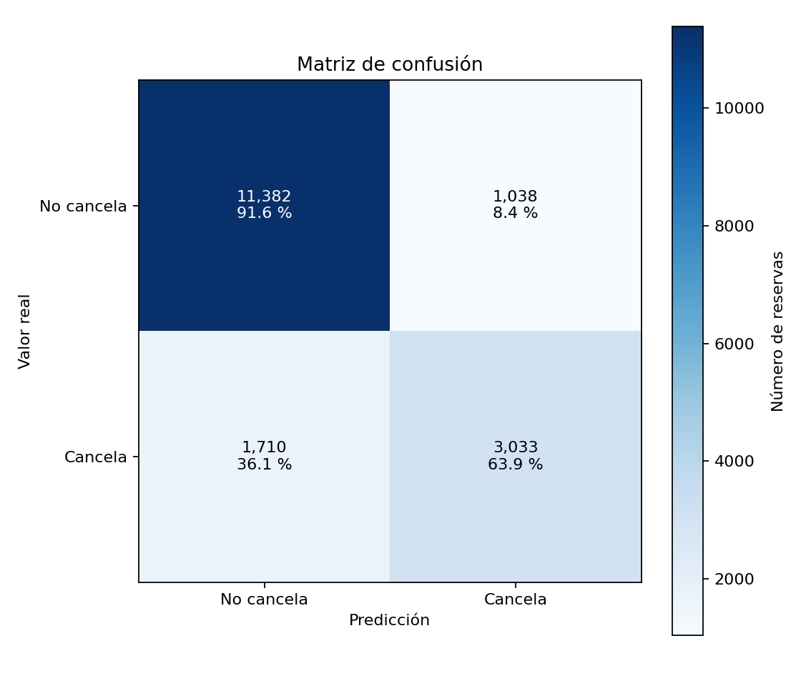
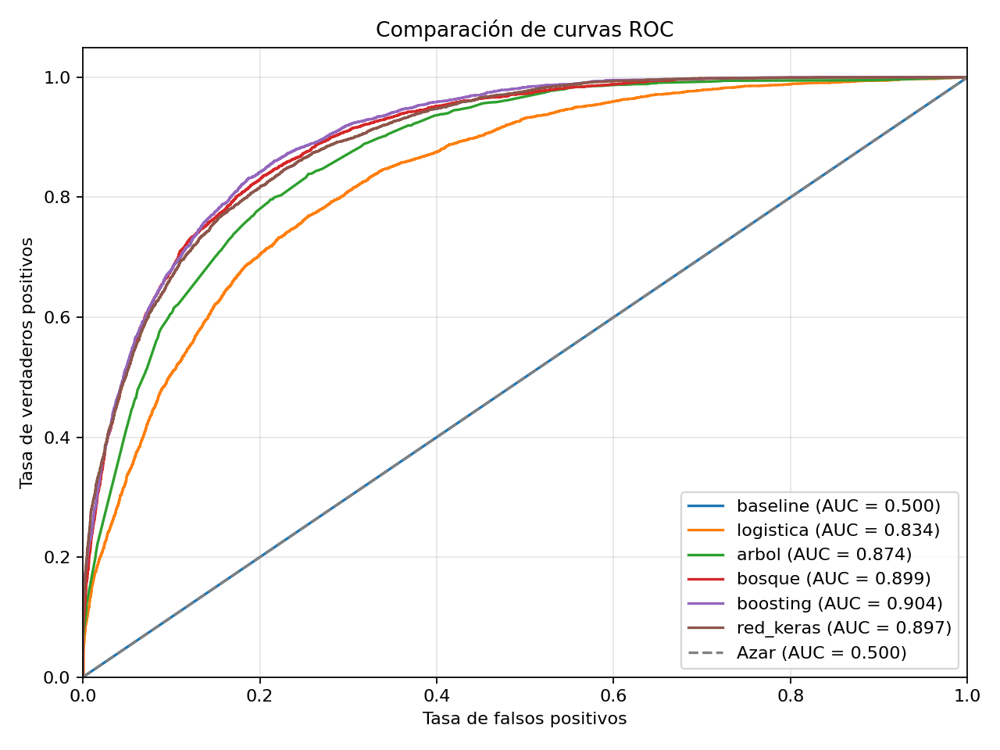
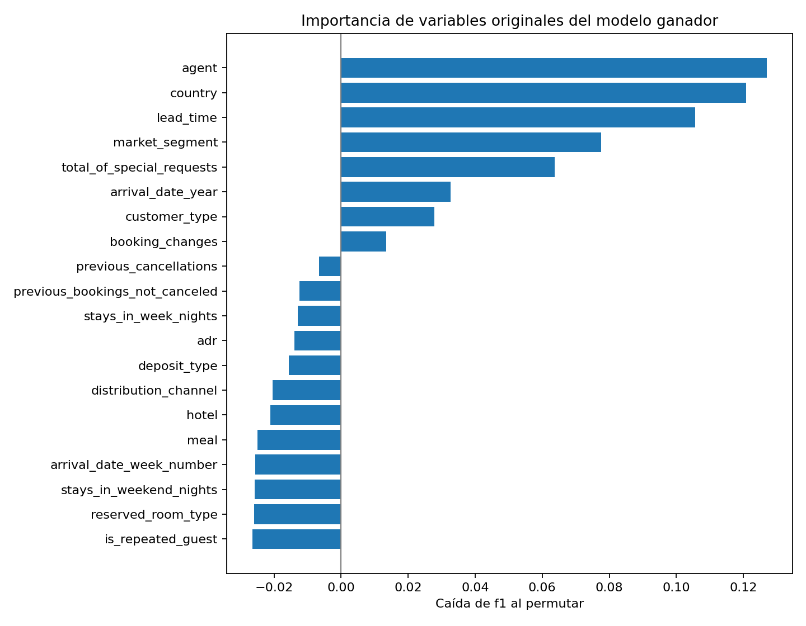

# Predicción de cancelación de reservas de hotel

Sistema modular que entrena, evalúa y compara seis modelos de clasificación binaria
sobre un conjunto de 119.390 reservas de hotel, selecciona el mejor según una métrica
justificada, y automatiza el flujo completo desde el CSV crudo hasta la inferencia.

> **Máster en IA, Cloud Computing y DevOps** · Machine Learning y Deep Learning
> Práctica de evaluación final · Entrega: 13 de octubre de 2026
>
> **Repositorio:** <https://github.com/kaiariel/pontia-tarea-ml>

---

## 1. Autores y roles

| Persona | Correo | De qué se hace cargo |
|---|---|---|
| Antonio (`tmllabres`) | tmllabres@gmail.com | Estructura del proyecto, `src/config.py`, contrato entre módulos (`tests/test_contrato.py`), `src/data_loader.py` (carga, limpieza, fugas, duplicados, partición y preprocesador), `src/model_trainer.py` (los seis modelos, bucle de comparación y guardado del artefacto) y el apartado 2 de este README |
| Ariel Castillo (`kaiariel`) | arielcastillo@outlook.com | `src/evaluator.py` (métricas, matriz de confusión, curvas ROC, importancia de variables e informe), `src/predictor.py` (carga del artefacto e inferencia), cierre del bucle de inferencia en `main.py`, ejecución oficial de `python main.py` y `outputs/`, apartados 1, 3 y 5–11 del README y exportación de `docs/informe_final.pdf` |

---

## 2. El problema y por qué este dataset

- **Objetivo:** predecir si una reserva se cancelará (`is_canceled = 1`) o no (`0`).
- **Tipo de problema:** clasificación binaria supervisada.
- **Filas del CSV crudo:** 119.390 · **Columnas:** 32 · **Predictoras reales:** 27
- **Reparto de clases en crudo:** 62,96 % no cancela / 37,04 % cancela (razón 1,70 : 1)
- **Tras la limpieza:** 85.811 filas · 72,36 % no cancela / 27,64 % cancela (razón 2,62 : 1)

El diccionario de variables está en [`docs/diccionario_datos.md`](docs/diccionario_datos.md).

### Para quién es, y qué decisión cambia

El destinatario es el departamento de *revenue management* del hotel, y la decisión
concreta que cambia es **cuántas habitaciones se vuelven a poner a la venta**.

Una reserva confirmada bloquea inventario. Si esa reserva se va a cancelar y nadie lo sabe
hasta el día de la llegada, la habitación ya no se puede vender a nadie: el inventario de
un hotel es perecedero, y la noche del 14 de agosto no se puede vender el día 15. Con una
probabilidad de cancelación **por reserva** se puede hacer overbooking controlado, decidir
a quién se le pide prepago o depósito, y dimensionar plantilla y compras en los días de más
riesgo.

Sin modelo, la única alternativa es aplicar la tasa media de cancelación a todo el mundo
por igual —que es, literalmente, lo que hace el clasificador trivial contra el que se mide
el sistema en el apartado 5.

### Qué le cuesta al hotel cada tipo de error

Los dos errores duelen, y no de la misma manera:

| Error | Qué pasa | Qué cuesta |
|---|---|---|
| **Falso negativo** — se predice «no cancela» y la reserva se cancela | La habitación se queda vacía sin que nadie lo viera venir | La noche entera, y no se recupera: no hubo margen para revenderla |
| **Falso positivo** — se predice «cancela» y el cliente aparece | El hotel ha revendido una habitación que sí se iba a ocupar y tiene que realojar al huésped | Compensación, traslado a otro establecimiento y una reseña negativa que dura mucho más que la noche |

El dataset **no trae el coste en euros de ninguno de los dos**, así que no se puede fijar
una razón coste-beneficio y optimizar por dinero. De ahí que la métrica del apartado 5 sea
F1 —que obliga a atender a los dos errores— y no una métrica asimétrica elegida a ojo. Es
también la limitación que se reconoce en el apartado 10.

### Fugas de datos detectadas y eliminadas

Una fuga es una columna que el modelo no tendría cuando toca predecir. Aquí se predice
**al hacerse la reserva o en las semanas siguientes, antes de que llegue el cliente**, que
es cuando revenue management decide el overbooking o el depósito. Todo lo que se escribe a
la llegada del cliente, o una vez se sabe si canceló, es la respuesta con otras palabras.

**Directas.** `reservation_status` y `reservation_status_date` determinan el objetivo al
100 % (`Check-Out` → 0; `Canceled` y `No-Show` → 1). Si se dejan, los modelos sacan un
AUC ≈ 1,000 y la comparación no distingue nada.

**Posteriores a la llegada.** Otras dos columnas se rellenan cuando el cliente llega, y
los datos lo delatan (cifras sobre el CSV crudo):

| Columna | Evidencia | Lectura |
|---|---|---|
| `required_car_parking_spaces` | 7.416 reservas con plaza: **0 canceladas y 0 No-Show**. Si se anotara al reservar, cabrían unas 2.670 cancelaciones y 75 No-Show; las peticiones especiales, que sí se hacen al reservar, cancelan un 21,7 % | La plaza se anota cuando el cliente llega en coche: quien no llega, nunca la tiene |
| `assigned_room_type` | Distinta de la reservada en el 18,8 % de las Check-Out y el 17,2 % de los No-Show, pero **solo en el 1,4 % de las canceladas** | La habitación se asigna el día de llegada (por eso los No-Show sí la tienen); quien cancela antes nunca llega a ese día |

Con las dos dentro, un gradient boosting sube el F1 en validación cruzada de **0,678 a
0,710** (y el AUC de 0,897 a 0,914) sobre las mismas filas. Es nota regalada: cuando toca
predecir, nadie tiene todavía plaza anotada ni habitación asignada.

**`booking_changes` se queda, con una duda declarada.** El CSV guarda el número *final* de
cambios, y parte puede ser posterior al momento de predecir. Pero no delata el desenlace
como las otras dos (con cambios cancela un 15,6 % frente a un 30,3 %: separa, pero no a la
perfección), y los cambios hechos hasta el momento de predecir sí son información legítima.
Queda como limitación para el apartado 10.

De ahí la cuenta: **32 − `is_canceled` − 4 de fuga = 27** columnas predictoras. Las cuatro
están en `config.FUGAS`, con su porqué.

### Los 33.413 duplicados exactos: se eliminan

Son el **28,0 %** del dataset, y el **61,3 %** de ellas son cancelaciones, así que no es una
decisión menor: mueve la prevalencia del objetivo casi diez puntos.

**Se eliminan.** Qué cuenta como duplicado: dos filas idénticas en las 28 columnas que
quedan tras quitar las fugas, es decir, en las 27 predictoras **y** en la respuesta. El CSV
no trae identificador de reserva, así que esas copias no se pueden distinguir entre sí. Las
filas que coinciden en las 27 predictoras pero acabaron de forma distinta (289 pares, 578
filas) **se conservan**: esas sí son, con seguridad, reservas distintas.

Dejar las copias tiene un coste asimétrico: si una cae en train y su gemela en test, el
modelo ya ha visto ese ejemplo exacto y su nota de test sale inflada **sin que salte ningún
error**. No es una hipótesis: si se parte el CSV sin deduplicar (misma semilla y
`stratify`), **7.813 de las 23.878 filas de test (32,7 %) tienen una gemela exacta en
train**, y cancelan un 58,2 % frente al 26,7 % del resto.

El precio, que se asume: las copias se concentran en reservas de grupo. Al deduplicar se va
el 93,1 % de las reservas `Non Refund` (de 14.587 a 1.011) y el 77,6 % del segmento
`Groups`, y la tasa de cancelación del City Hotel baja del 41,73 % al 30,21 %. Algunas de
esas filas serán habitaciones legítimas de un mismo grupo; perderlas es un precio menor que
publicar una métrica de test que no es honesta.

El orden de la limpieza importa, y está fijado en `data_loader.limpiar()`:

1. **Primero las fugas.** El modelo nunca las ve, así que no pueden decidir qué es un
   duplicado. Con ellas dentro saldrían 31.994 duplicados en vez de 33.413: 1.419 filas
   idénticas en todo lo que ve el modelo sobrevivirían solo por diferir en una columna de
   fuga.
2. **Después los duplicados**, y siempre **antes de particionar**. Si se particiona primero,
   la propia partición ya ha repartido las gemelas entre los dos lados.
3. **Por último los imposibles:** 1 reserva con `adr` negativo (−6,38) y 165 sin ningún
   huésped (0 adultos, 0 niños y 0 bebés). No son valores raros discutibles: un precio
   negativo no es un precio, y una reserva sin personas no es la reserva de nadie. Su
   etiqueta no describe a ningún cliente —16 de esas 165 constan como canceladas—, así que
   solo aportarían ruido.

Lo que **no** se borra, a propósito, porque es raro pero posible:

- **218 reservas con 0 adultos pero con niños o bebés.** «Sin huéspedes» es la suma de las
  tres columnas, no `adults == 0`.
- **1.619 reservas con `adr = 0`.** Entre ellas están las 621 del segmento `Complementary`
  (invitaciones del hotel) y las 587 de 0 noches; un precio 0 no es imposible.
- **Una reserva con `adr = 5.400`**, cuando el siguiente valor más alto es 510. Es un valor
  extremo, no imposible. Con esta partición cae en el test, así que no afecta al escalado,
  que se aprende solo con el train.

**Consecuencia asumida.** La prevalencia de cancelación baja de 37,04 % a **27,64 %**, y con
ella sube el acierto del modelo trivial de 62,96 % a **72,36 %** —que es justo el argumento
del apartado 5 contra usar accuracy como criterio. Los números de los apartados 5, 7 y 8
salen todos de esta misma decisión: de las 85.811 filas limpias, **68.648 van a train y
17.163 al test**, con un 27,64 % de cancelaciones en cada mitad (`stratify=y`).

---

## 3. Análisis exploratorio (EDA)

| Hallazgo | Evidencia | Decisión que tomamos |
|---|---|---|
| Clases desbalanceadas | Tras limpiar, 72,36 % no cancela / 27,64 % cancela | F1 de la clase «cancela» como métrica principal; accuracy solo como secundaria |
| Fuga directa | `reservation_status` determina el objetivo al 100 % | Excluir `reservation_status` y `reservation_status_date` |
| Fuga posterior a la llegada | 7.416 reservas con plaza de parking y 0 canceladas | Excluir `required_car_parking_spaces` y `assigned_room_type` → quedan 27 predictoras |
| Duplicados exactos | 33.413 filas (28,0 %); sin deduplicar, el 32,7 % del test tendría una gemela exacta en train | Deduplicar antes de particionar → 85.811 filas |
| Nulos y alta cardinalidad | `company` 94,31 % nulos, `agent` 13,69 %; 177 países, 333 agentes y 348 empresas | Imputar dentro del Pipeline; top 10 + «otros» en `country`, `agent` y `company` |
| Depósito no reembolsable | `Non Refund` cancela un 94,9 % frente al 26,8 % de `No Deposit` | Conservar `deposit_type`: asociación fuerte, no causa |
| Canal y tipo de hotel | `Online TA` cancela un 35,3 % frente al 12,1 % de `Corporate`; City Hotel 30,2 % frente a Resort 23,6 % | Conservar `market_segment` y `hotel` como predictoras |
| Antelación de la reserva | Mediana de `lead_time`: 37 días (no cancela) frente a 79 días (cancela) | Conservar `lead_time`; imputación por mediana y escalado dentro del Pipeline |

Detalle en [`notebooks/finales/eda_final.ipynb`](notebooks/finales/eda_final.ipynb).

---

## 4. Diseño del sistema

```
pontia-tarea-ml/
├── main.py                          orquestador: python main.py
├── requirements.txt                 dependencias con versión fijada
├── .python-version                  3.12
├── .gitignore
│
├── src/
│   ├── config.py                    parámetros, rutas, semilla y umbral
│   ├── data_loader.py               cargar, limpiar, partir, preprocesador
│   ├── model_trainer.py             registro de modelos y bucle comparador
│   ├── evaluator.py                 métricas y figuras; único que abre el test
│   └── predictor.py                 inferencia con el modelo entrenado
│
├── notebooks/
│   ├── exploracion/                 la cocina: se prueba y se falla
│   │   └── eda_inicial.ipynb
│   └── finales/                     el escaparate: lo que se defiende
│       ├── eda_final.ipynb
│       └── comparativa_modelos.ipynb
│
├── tests/                           pytest: contrato del registro y de la limpieza
│   ├── conftest.py
│   ├── test_data_loader.py
│   └── test_model_trainer.py
│
├── data/
│   ├── raw/dataset_practica_final.csv   el CSV original, intacto y versionado
│   └── processed/                   intermedios (no se versiona)
│
├── models/                          artefactos entrenados (no se versiona)
│   ├── mejor_modelo.pkl             el Pipeline COMPLETO: preprocesado + modelo
│   ├── mejor_modelo.keras           solo si gana la red
│   └── metadatos.json               ganador, umbral, columnas, semilla, versiones
│
├── outputs/                         generado por evaluator.py, SÍ se versiona
│   ├── confusion_matrix.png
│   ├── roc_curve.png                los seis modelos en los mismos ejes
│   ├── feature_importance.png
│   ├── tabla_comparativa.csv
│   └── metricas_test.json
│
└── docs/
    ├── diccionario_datos.md         las 32 variables del CSV
    ├── guion_practica.pdf           el enunciado
    └── informe_final.pdf            este README exportado: lo que se sube a PontIA
```

**Decisiones de diseño que hay que poder defender:**

- **Un módulo, una responsabilidad.** Cada uno se describe en una frase sin usar «y».
- **La partición se hace una sola vez**, en `data_loader`. Si cada módulo partiera por
  su cuenta, cada modelo se compararía contra un reparto distinto.
- **Todo lo que aprende un número de los datos va dentro del `Pipeline`** (medianas,
  categorías, medias del escalado), para que se ajuste solo con el train de cada fold.
  Lo que **borra filas** (duplicados, imposibles) va fuera y antes de partir.
- **Registro de modelos con interfaz común**, imitando por dentro a una librería de
  AutoML: añadir un modelo más es una clase y una línea, sin tocar el bucle.
- **Semilla única** (`config.SEMILLA = 42`) para partición, modelos y validación cruzada.
- **El artefacto es el Pipeline completo** (preprocesado + modelo) más `metadatos.json`
  con el umbral congelado y las columnas de entrada. `predictor.py` aplica el umbral del
  artefacto, no el de `config`, y `main.py` termina recargándolo y prediciendo para
  demostrar el flujo completo hasta la inferencia.

---

## 5. Métrica principal y por qué

**Métrica principal:** F1 de la clase positiva («cancela») · **Secundarias:** accuracy, precision, recall, ROC-AUC.

Tras la limpieza, un modelo que dijera siempre «no cancela» acierta el **72,36 %** sin
aprender nada: en la tabla del apartado 7 el baseline saca accuracy 0,7236 y F1 0,00.
Accuracy premia ignorar justo la clase que interesa, así que no sirve como criterio.

Se elige F1 porque al hotel le duelen los dos errores (apartado 2): un **falso negativo**
deja una habitación vacía que ya no se puede revender, y un **falso positivo** obliga a
realojar a un cliente que sí venía. Optimizar solo recall empujaría a marcar «cancela» a
casi todo el mundo (overbooking agresivo y clientes realojados); optimizar solo precision
dejaría escapar la mayoría de cancelaciones. Como el dataset no trae el coste en euros de
cada error, no hay base para ponderar uno por encima del otro: F1 obliga a no sacrificar
ninguno. La métrica se fijó antes de entrenar (`config.METRICA_PRINCIPAL = "f1"`) y no se
cambió después.

---

## 6. Cómo ejecutar el proyecto

**Requisitos:** Python 3.12

```bash
git clone https://github.com/kaiariel/pontia-tarea-ml.git
cd pontia-tarea-ml

python -m venv .venv
.venv\Scripts\activate          # Windows
# source .venv/bin/activate     # macOS / Linux

python -m pip install -r requirements.txt
```

<details>
<summary>Alternativa rápida con <code>uv</code> (opcional)</summary>

Si tienes [uv](https://docs.astral.sh/uv/) instalado, lee el mismo `requirements.txt`
y tarda bastante menos —importa, porque TensorFlow son varios cientos de MB:

```bash
uv venv --python 3.12
uv pip install -r requirements.txt
```

No es necesario: los pasos de arriba con `pip` funcionan igual.
</details>

**Pipeline completo** (carga → limpieza → entrenamiento → comparación → evaluación → artefacto):

```bash
python main.py
```

**Versión corta para la defensa** (muestra reducida, menos folds y menos épocas en la red):

```bash
python main.py --demo
```

**Inferencia con el modelo ya entrenado, sin reentrenar nada:**

```bash
python -m src.predictor
```

> `models/` está en el `.gitignore`, así que en un clon recién hecho **todavía no existe
> ningún artefacto**: hay que lanzar `python main.py` (o `--demo`) al menos una vez antes
> de que la inferencia funcione.

Salidas: figuras y tablas en `outputs/`, modelo en `models/`.

---

## 7. Modelos comparados

Los seis modelos (el baseline más los cinco que exige el enunciado), entrenados con el
mismo protocolo: mismo `StratifiedKFold` de 5 folds, misma semilla, preprocesado dentro
del `Pipeline` y `scoring` fijado a la métrica principal. Media ± desviación entre folds
sobre las 68.648 filas de train, copiada de `outputs/tabla_comparativa.csv`.

| Modelo | F1 (CV) | Accuracy | Precision | Recall | ROC-AUC | Tiempo |
|---|---|---|---|---|---|---|
| Gradient Boosting (XGBoost) | 0,6856 ± 0,0098 | 0,8379 ± 0,0048 | 0,7390 ± 0,0093 | 0,6394 ± 0,0104 | 0,9000 ± 0,0048 | 17,1 s |
| Red neuronal (Keras) | 0,6659 ± 0,0134 | 0,8313 ± 0,0039 | 0,7352 ± 0,0047 | 0,6090 ± 0,0231 | 0,8904 ± 0,0045 | 99,3 s |
| Random Forest | 0,6543 ± 0,0068 | 0,8331 ± 0,0034 | 0,7653 ± 0,0087 | 0,5714 ± 0,0057 | 0,8947 ± 0,0050 | 39,1 s |
| Árbol de decisión | 0,6372 ± 0,0057 | 0,8161 ± 0,0037 | 0,7012 ± 0,0159 | 0,5846 ± 0,0158 | 0,8694 ± 0,0059 | 4,8 s |
| Regresión logística | 0,5418 ± 0,0068 | 0,7859 ± 0,0029 | 0,6633 ± 0,0074 | 0,4579 ± 0,0073 | 0,8307 ± 0,0043 | 6,4 s |
| Baseline (`DummyClassifier`) | 0,0000 ± 0,0000 | 0,7236 ± 0,0000 | 0,0000 ± 0,0000 | 0,0000 ± 0,0000 | 0,5000 ± 0,0000 | 4,1 s |

El baseline marca el suelo y todos los modelos lo superan. La distancia entre la
logística (0,54) y los modelos de árboles (0,64–0,69) indica que la relación entre las
variables y la cancelación no es lineal.

---

## 8. Resultados y elección final

**Modelo elegido:** XGBoost (`boosting`).

**Por qué gana.** Tiene el F1 medio más alto en validación cruzada (0,6856 ± 0,0098),
2 puntos por encima de la red Keras (0,6659) y 3 por encima del Random Forest (0,6543),
y además entrena en 17 s frente a los 99 s de la red. Su ventaja sale sobre todo del
recall: detecta más cancelaciones que el bosque (0,64 frente a 0,57) sin perder mucha
precision. El boosting añade árboles que corrigen los errores de los anteriores, lo que
encaja con interacciones como agente × país × antelación que un modelo lineal no captura.

Métricas del ganador sobre el conjunto de test (**N = 17.163 reservas nunca vistas**,
umbral 0,5), copiadas de `outputs/metricas_test.json`:

| Métrica | Valor |
|---|---|
| F1 | 0,6882 |
| Accuracy | 0,8399 |
| Precision | 0,7450 |
| Recall | 0,6395 |
| ROC-AUC | 0,9037 |

El F1 de test (0,6882) es casi idéntico al de validación cruzada (0,6856): no hay señal
de sobreajuste. En cifras absolutas, de unas 4.744 cancelaciones reales del test el
modelo detecta unas 3.033 y se le escapan unas 1.710; de cada 4 alarmas que da, 3 aciertan.

### Matriz de confusión



### Curvas ROC de los seis modelos



### Importancia de variables del ganador

Calculada con `permutation_importance` sobre el Pipeline completo: mide cuánto cae el F1
al desordenar cada variable original, sin tener que deshacer el one-hot y válida para
cualquier ganador.



Las variables que más pesan son `agent`, `country`, `lead_time`, `market_segment` y
`total_of_special_requests`, en línea con lo que señalaba el EDA (canal, origen y antelación).

---

## 9. Conclusiones

- **El sistema funciona de punta a punta:** CSV crudo → limpieza → seis modelos con el
  mismo protocolo → evaluación única sobre el test → artefacto guardado → inferencia con
  `python -m src.predictor`, sin reentrenar.
- **XGBoost aporta valor real sobre lo trivial:** F1 0,69 frente a 0,00 del baseline y
  ROC-AUC 0,90 frente a 0,50.
- **Uso práctico:** con una probabilidad de cancelación por reserva, revenue management
  puede pedir depósito o hacer overbooking controlado sobre las reservas de mayor riesgo,
  en lugar de aplicar la tasa media del 27,6 % a todas por igual.
- **Lo que no resuelve:** con umbral 0,5 se le escapa aproximadamente el 36 % de las
  cancelaciones. No es un sistema perfecto ni demuestra un ahorro concreto en euros.
- **Lo que aprendimos:** las decisiones sobre los datos movieron la nota más que la
  elección del algoritmo. Quitar las dos fugas posteriores a la llegada bajó el F1 de
  0,710 a 0,678, y sin deduplicar un tercio del test habría tenido copias en train: sin
  esas decisiones, la métrica publicada habría sido más alta y menos honesta.

---

## 10. Reflexión crítica: limitaciones y mejoras

- **Sin búsqueda de hiperparámetros** (`config.BUSQUEDA = None`): los modelos usan
  valores razonables fijados a mano; un `RandomizedSearchCV` podría mejorarlos.
- **Validación cruzada no anidada:** esos valores se fijaron mirando los mismos folds con
  los que se mide, así que el F1 de CV puede ser algo optimista. El test, medido una sola
  vez, da una cifra muy parecida (0,6882), lo que reduce esta preocupación.
- **Partición aleatoria, no temporal:** en producción se predice el futuro. Una partición
  por fecha de llegada sería más fiel y probablemente daría una cifra algo peor.
- **Sin coste en euros de cada error:** el umbral 0,5 no está optimizado por dinero. Con
  esos costes se podría mover el umbral para aceptar más falsos positivos a cambio de
  menos cancelaciones no detectadas.
- **`booking_changes` puede contener información posterior** al momento de predecir; se
  conservó con esa duda declarada (apartado 2).
- **Deduplicar es una hipótesis:** sin identificador de reserva, algunas habitaciones
  legítimas de un mismo grupo pueden haberse eliminado (se perdió el 93 % de las
  reservas `Non Refund`).
- **Correlación, no causa:** que `Non Refund` u `Online TA` cancelen más no significa que
  el depósito o el canal causen la cancelación.
- **Importancias con ruido:** la permutación se calculó sobre una muestra de 1.000 filas y
  3 repeticiones; los valores negativos pequeños de la figura son ruido de muestreo y solo
  es fiable el orden de las primeras variables.

---

## 11. Bonus técnicos implementados

No se implementaron bonus técnicos: se priorizó que el flujo obligatorio funcionara completo y bien justificado.

---

## Anexos

- [Diccionario de variables](docs/diccionario_datos.md) — las 32 columnas del CSV
- [Guion de la práctica](docs/guion_practica.pdf) — el enunciado del profesor
- Notebooks que se defienden:
  - [`notebooks/finales/eda_final.ipynb`](notebooks/finales/eda_final.ipynb) — el EDA presentable
  - [`notebooks/finales/comparativa_modelos.ipynb`](notebooks/finales/comparativa_modelos.ipynb) — la tabla y las figuras
- Notebooks de trabajo (la cocina): [`notebooks/exploracion/`](notebooks/exploracion/)

**Tests:** `python -m pytest -q` desde la raíz.
